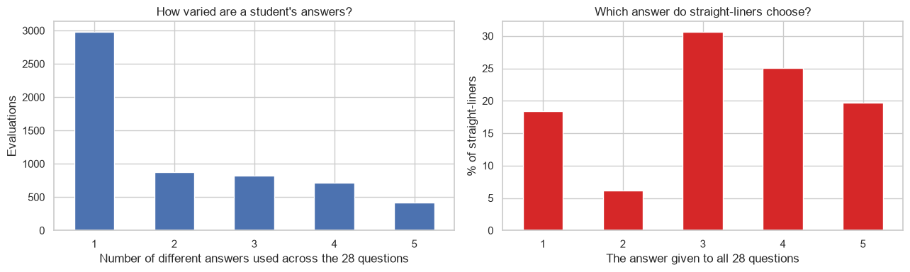
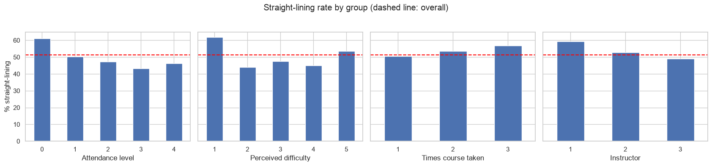

# How students really fill in course evaluations

An analysis of 5,820 end-of-term course evaluations from a Turkish university, each with 28 questions on a 1-5 scale. It started as a look at which aspects of teaching students rate highest, and became a study of how the forms are filled in.



## Findings

- **Half the forms carry one number.** 51% of students gave the same answer to all 28 questions, and another 15% used only two different answers. If answers were independent, an all-identical form would have a probability of about 10⁻¹⁵.
- **Straight-liners are not all picking the middle.** 31% chose 3 throughout, 25% chose 4, 20% chose 5 and 18% chose 1.
- **Who does it:** students who never attend (61%, against 43-50% for others) and those who found the course very easy (62%) or very hard (54%). By course, the rate runs from 34% to 69%.
- **The questionnaire's structure is hidden by it.** With everyone included, one principal component explains 82% of the variation: 28 questions behave like one. Among students who varied their answers that falls to 60%, and the second component separates the 12 course questions from the 16 instructor questions.
- **Instructor comparisons hold up; course rankings less so.** The lowest-rated instructor is lowest whichever group is used. Course rankings computed from all students and from varied responders have a rank correlation of 0.74, and one small course moves from 11th of 13 to 4th.



## What to take from it

A mean evaluation score is mostly a measure of overall sentiment, and for small courses it depends on who rushed the form. Reporting the straight-lining rate next to each score, and checking whether a ranking holds among students who varied their answers, shows which comparisons can be trusted.

A student who answers 4 to everything may mean it, so the notebook reports each number both ways instead of treating one as correct.

## Methods

Descriptive statistics, chi-square tests of independence, correlation analysis, principal component analysis and rank correlation, in pandas, SciPy and scikit-learn.

## Data

`data/turkiye-student-evaluation_generic.csv`: the Turkiye Student Evaluation dataset from the [UCI Machine Learning Repository](https://archive.ics.uci.edu/dataset/262/turkiye+student+evaluation) (Gunduz and Fokoue, 2013), licensed CC BY 4.0. Columns: instructor, course, number of times the course was taken, attendance level, perceived difficulty, and questions Q1 to Q28.

## Running it

```bash
pip install -r requirements.txt
jupyter notebook notebook.ipynb
```

## License

The code is released under the [MIT License](LICENSE). Datasets keep the terms of their original sources, described above.
